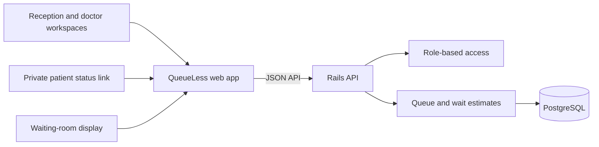

# QueueLess

**A clearer, calmer way to manage clinic visits.**

QueueLess is a web application that helps clinics coordinate the flow of patients from arrival to consultation. Reception staff can register visits and manage the waiting queue, doctors can see who is coming next and why they are visiting, and patients can follow their place in line. A dedicated waiting-room screen shows token updates without displaying patient names.

## Why QueueLess

In a busy clinic, staff and patients need the same simple answer: **who is next, and how long might the wait be?** QueueLess replaces paper lists and repeated verbal updates with a shared, continuously refreshed queue. Daily tokens, queue status, and estimated waiting times help staff coordinate visits while giving patients clearer expectations.

## What it does

- Registers patient visits and assigns daily queue tokens.
- Shows reception staff the live queue and provides controls to call, complete, or skip a visit.
- Gives doctors an overview of upcoming patients and their visit requirements.
- Estimates waiting time using queue position and recorded service times.
- Lets patients check their visit status through a private token link.
- Provides a dedicated waiting-room display at `/display/:queueId`, designed to show tokens without patient names.
- Gives administrators queue settings and downloadable daily, weekly, and yearly CSV reports.
- Adapts to desktop, tablet, mobile, and large waiting-room displays.

## Who uses it

| Role | Main tasks |
| --- | --- |
| **Receptionist** | Register arrivals, manage the waiting queue, and share a patient's private status link. |
| **Doctor** | Review incoming patients, visit requirements, and queue progress. |
| **Administrator** | Configure queue settings and export operational reports. |
| **Patient or visitor** | Check queue progress through a private link or view token updates on the clinic screen. |

## How it works

The React application provides staff workspaces, private patient status pages, and the public waiting-room display. It communicates with a Ruby on Rails JSON API, which applies access rules and queue logic and stores visits and queue data in PostgreSQL. The web application refreshes queue information periodically so the different views stay up to date.



## Technology

- **Frontend:** React 18, TypeScript, Vite, Tailwind CSS, React Router
- **Backend:** Ruby, Rails API, and Active Record
- **Database:** PostgreSQL
- **Quality tools:** Vitest, React Testing Library, and RSpec

## Project structure

```text
frontend/  React application, user interfaces, and frontend tests
backend/   Rails API, queue services, data models, and backend tests
docs/      API, architecture, and database reference documentation
```

## Local preview

To explore the application locally, run the Rails API and the Vite frontend in separate terminals. The backend uses PostgreSQL. From the repository root, prepare the backend in WSL:

```bash
cd backend
cp .env.example .env
# Set PGUSER in .env to your local PostgreSQL role.
createdb queueless_development
createdb queueless_test
bundle install
bundle exec rails db:migrate db:seed
bundle exec rails server
```

Then start the frontend in a Windows PowerShell terminal:

```powershell
cd frontend
Copy-Item .env.example .env
npm.cmd ci
npm.cmd run dev
```

Open `http://localhost:5173`. The seeded local database contains fictional sample visits and demo accounts: `admin` / `admin`, `doctor` / `1234`, and `receptionist` / `1234`. These accounts and records are for local demonstration only.

## Further project documentation

- [API reference](docs/API_DOCUMENTATION.md)
- [Architecture notes](docs/ARCHITECTURE.md)
- [Database schema](docs/DATABASE_SCHEMA.md)

## Project status

QueueLess is an evolving clinic queue application. Its sample data is fictional. Review privacy, security, and applicable requirements before using sensitive patient information.
