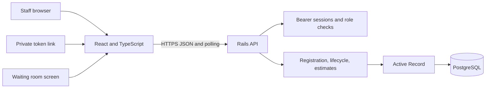

# QueueLess architecture

## Components

The React/Vite frontend owns navigation and presentation for staff, customer token status, and public display routes. The Rails API owns identity/session validation, authorization, request validation, token sequence allocation, queue transitions, estimates, and report generation. PostgreSQL stores queues, visits, staff users, and sessions.

## Access boundaries

- Staff routes require an unexpired bearer session and enforce administrator, doctor, or receptionist role rules.
- Administrators manage queue settings and download CSV reports. Receptionists register and operate queue visits. Doctors can review patient queue data and visit requirements but cannot operate the queue.
- Public customer lookup uses an opaque token and returns only that customer's queue status and estimate.
- Public display lookup uses the queue ID and returns queue labels, token numbers, positions, and estimated times. It never returns patient identity, contact details, visit requirements, staff notes, or database IDs.
- Development seeds create labeled fictional visits and simple local demo accounts. Production seeds create only queues and explicitly configured staff accounts.

## Queue and estimate behavior

Registration allocates a daily sequential token while locking the queue row. A unique database index protects the queue/date/sequence tuple. Queue transitions are validated in a service object; one active serving visit per queue is allowed. Waiting position is FIFO, with returned skipped visits placed at the end.

For wait estimates, the API uses completed visit durations from the current service date when available, ignoring durations under two minutes. Otherwise it uses the queue's configured average. A currently serving visit consumes the remaining estimated service duration for visits behind it. Estimates are informational and can change when services take longer or shorter than expected.

## Hosting model

Deploy the frontend as a static site, the backend as a Rails web service, and PostgreSQL as a managed database. Configure the production API with the exact frontend origin for CORS and configure the frontend's build-time `VITE_API_BASE_URL` to point to the API. The frontend host must rewrite client-side routes to `index.html` so `/display/:queueId` and `/token/:lookup` work when opened directly.

See [Hosting guide](DEPLOYMENT_GUIDE.md), [API reference](API_DOCUMENTATION.md), and [database schema](DATABASE_SCHEMA.md).

## Known limitations

This is an MVP and requires a security/privacy assessment before real patient data is used. The current implementation has no login throttling, password reset/change flow, audit history, or complete healthcare compliance controls. Report exports include identifying visit data and must be handled as sensitive files.
